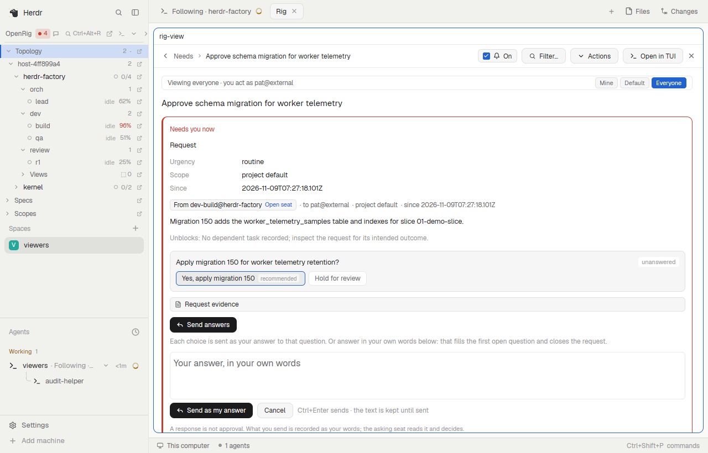

# OpenRig Mod for Herdr

> **EARLY DEVELOPMENT** — This mod is in early development. Contributions are welcome.

A sidebar mod that brings an OpenRig rig into the `herdr` window: six collapsible branches of live topology, specs, scopes, terminals, needs-you items, and system state (`rig`), a graphical Page tab (`rig-view`), a command palette on `ctrl-alt-r` (`rig-palette`), and right-click menus (`rig-menu`).

## Install

Give [`RECIPE.md`](RECIPE.md) to your `herdr` agent. It walks through checking or setting up OpenRig, copying the four mod folders (`mods/rig`, `mods/rig-view`, `mods/rig-palette`, `mods/rig-menu`) into `<appHome>/mods/`, merging `ctrl-alt-r` into `keys.json`, and fitting `{ "mod": "rig" }` into your layout.

## Requirements

- **Herdr** (`herdr-app` + `hc`).
- **OpenRig** (`rig` CLI and local daemon). Works with your existing OpenRig setup as-is: Decision Card actions and core browsing work on OpenRig `0.7.7+`, optimistic concurrency (`expectedRevision`) and idempotent `operationId` retries use `0.7.9+`, and controls whose CLI flags are absent on older OpenRig versions are disabled in place with their reason rather than failing.

## License

[MIT](LICENSE) — Copyright (c) 2026 w4rc0n.
