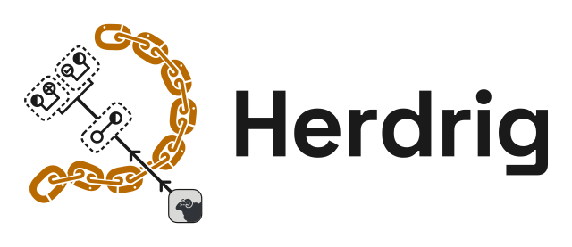
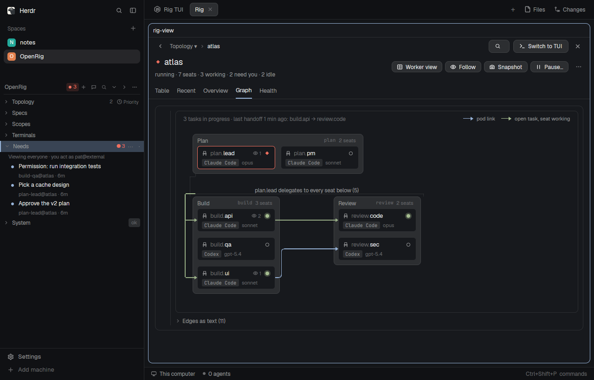
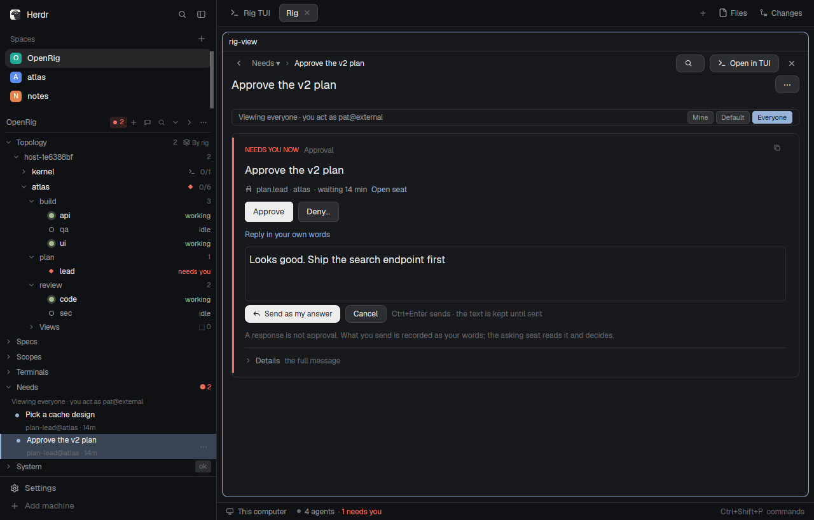
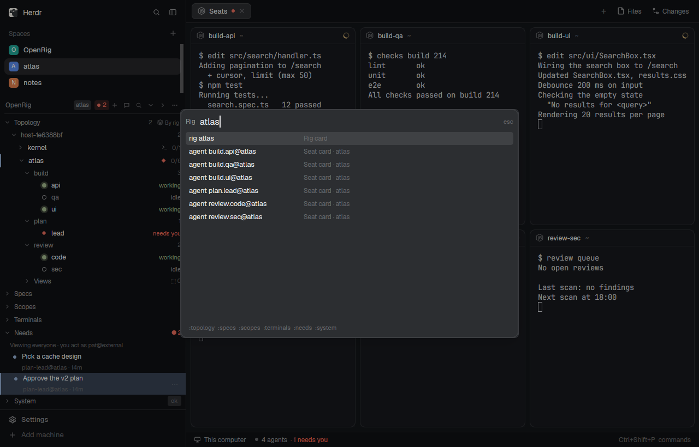

<p align="center">
  <picture>
    <source media="(prefers-color-scheme: dark)" srcset="assets/logo/herdrig-logo-dark.svg">
    
  </picture>
</p>

# Herdrig

Version: v0.5.19

**[OpenRig](https://github.com/mvschwarz/openrig) Mod for [Herdr](https://github.com/herdrdev/herdr-app)**

> **EARLY DEVELOPMENT** — This mod is in early development. Contributions are welcome.


Herdrig puts [OpenRig](https://github.com/mvschwarz/openrig) inside the [Herdr](https://github.com/herdrdev/herdr-app) window: your rigs, their seats and the
decisions waiting for you, in a sidebar beside your own tabs. Select a row, then double-click or press Enter to open its page, and you can
act from there (answer a request, message a seat, attach to it) without leaving Herdr.

Inside Herdr, use Herdrig’s views. To open OpenRig’s own terminal view there, use `rig terminal open --window`.

## A closer look



See your team as a graph: who delegates to whom, who's working, and who needs you.



Answer your agents' requests and approve their work without leaving Herdr.



The Rig palette: jump to any rig, seat or page from the keyboard.

## Features

- **Box setup:** choose OpenRig's connected Herdr machine in one screen naming its account, helper and SHA-256.
  A changed helper asks again; existing Local spaces offer Move or Keep here.
- **Specs on the box:** Save and Copy & edit use separate permission for the box's spec folders, with a verified
  helper, changed-file checks and draft recovery. Built-ins stay unchanged; copies retain their built-in agent references.
- **Clear page navigation:** location breadcrumbs and one tab row per object; narrow pages stack labels and controls.
- **Workflow views:** Scopes shows a mission's workflows, current packets, obligations and plan sources. Suggested
  commands are copyable text, never run by Herdrig. Lifecycle receipts are not product acceptance.
- **Not reported:** a running seat without a usable activity report has its own dashed mark, group and filter;
  it never counts as idle.
- **Absolute times:** UTC and Etc/UTC are supported exactly. Other configured zones use this computer's local time,
  with a quiet note in Configuration; exact timestamps include their numeric offset. Relative ages are unchanged.
- **Seat now lines:** visible screen narration and tool status beside rig rows, with selectable cleaned lines on
  hover and on the seat page. Drafts, incoming messages and terminal seats are excluded; ambiguous input stays blank.
- **Quiet while I type:** an agent seat's menu can keep OpenRig's reminders out of its pane. Its Activity page shows
  the typing guard and held messages; held messages are read-only and never replayed when the guard is turned off.
- **Calm status marks:** working dots stay visible without continuous animation; a seat starting work or a new
  request gets one brief pulse. Action spinners still show work in progress.

- **Archive and Restore:** hide a rig reversibly from its menu, then restore it stopped from Topology's Archived list.
- **Terminal links (Herdr 0.1.17+):** Ctrl-click a recognized OpenRig link or `/api/…` address in any Herdr terminal to open it on the Rig page. Plain request IDs stay plain text; `--no-links` opts out.
- **Plain seat activity:** readable status and context, with copyable raw details in **How OpenRig knows**.
- **Sidebar tree** with six branches: **Topology** (host, rig, pod, seat, helper), **Specs**, **Scopes**,
  **Terminals**, **Needs** and **System**, each seat with its status and context usage.
- **Spaces list and layout:** open **System → Layout** in the sidebar or on the System page to choose Herdr's Spaces list, herdrig's list, or both.
- **Configuration:** Pages with more than 30 settings open one category at a time. A category or search shows up to 40 settings. Rows you are editing, selecting or reviewing stay visible, and counts show how many more settings there are. Use the filter to find another setting, or navigate category headers with Enter, Space and the arrow keys. Small pages stay expanded.
- **The Page:** the full view of whatever you select. A rig, a seat card, a spec you can edit in place, or the files
  OpenRig reports.
- **Rig graphs:** saved rig specs start with a static Graph/YAML view and Launch. Running rigs and specs center pod
  columns beneath the lead pod in the rig spec's own pod order, wrap long pod names instead of truncating them, keep
  in-pod chains stacked together, and summarize broad delegation in a heading above the columns (naming one or two
  skipped seats, or a count for three or more). Seat cards show observer counts and green open-task badges; links that
  exceed a gap's capacity, cross wrapped rows, or appear at narrow widths stay clickable as card tags. Select a seat to
  see who gives it work, who watches it, whom it sends work to, and its open tasks (with **Open seat page** on running
  rigs); use the left and right arrow keys to step through seats and **Escape** to return to the graph. Running rigs
  also show active work and briefly lit handoff paths: work from a heading delegator highlights the target seat's
  border without drawing a wire over the heading, while work along a pod link lights that link (pulsing green while
  working, dashed after a 15-second idle grace period, amber when a seat needs you or is blocked, and muted when
  stopped or unreachable). The legend explains the lines on screen. Hover a task badge or task line for summaries and
  ages, and use the folded **Edges as text** list for copyable edges. Saved previews come from your connected OpenRig
  server, including a host-to-box tunnel. Set `"reducedMotion": true` in `<appHome>/openrig/config.json` to skip
  entrance, fades and status pulses.
- **Needs answered in place:** human requests render as Decision Cards (Approve, Deny with a reason, answer the
  questions, or reply in your own words), with quiet hours and modes in **System → People**. On OpenRig 0.7.24 and
  later, a seat's permission request gets its own row under **Needs you** in Topology's Priority view and opens
  directly on **Allow once** or **Deny**.
- **Command palette** on `ctrl-alt-r`.
- **Connected assistants:** queue-checking team members have a folded group under their rig, All seats rows and a read-only detail page. Their own check-in words stay separate from activity counts; Queue work, Copy address and Open rig page are their only actions. Older OpenRig versions without the roster route show nothing.
- **Right-click menus** on seats (send, queue, pause or resume, change model), Needs requests, specs and slices.
- **Attach** opens a live seat in its own tab, and Herdr's **Agents** section shows its status.
- **Follows your space:** the sidebar folds outside OpenRig's spaces, keeping Needs you and search visible. Click its
  header to expand until you change spaces. Pages and Needs alerts go to their rig's existing space or the **OpenRig** home, which
  also holds the TUI on OpenRig's selected machine. Personal spaces stay free of new Rig tabs. Existing tabs offer **Move** or **Keep here**.
- **More than one OpenRig:** one sidebar for this computer's OpenRig and your Herdr machines'; see
  [Using more than one OpenRig](#using-more-than-one-openrig).
- **Works with or without OpenRig running:** when OpenRig is missing, stopped or unhealthy, the sidebar says so in
  plain words, with the fix (for example **Start OpenRig**). Controls your OpenRig version doesn't support are greyed
  out, each with its reason.

## Install

In Herdr, tell your agent:

```
Read ~/.config/herdr-app/AGENTS.md, then add this mod: herdr.dev/mods/w4rc0n/herdrig
```

Or give [`RECIPE.md`](RECIPE.md) to your agent in Herdr. It checks for OpenRig (and installs it with OpenRig's own guide
only on your yes), copies `mods/rig`, `mods/rig-view`, `mods/rig-palette`, `mods/rig-menu` and `mods/rig-spaces` (plus `mods/rig-link` on Herdr 0.1.17 or later: six folders in all, five on older Herdr)
into `<appHome>/mods/`, merges `ctrl-alt-r` into `keys.json`, and adds `{ "mod": "rig" }` to your layout after telling
you.

Herdr doesn't review mods: check what your agent runs and which keys it changes.

On Herdr 0.1.17 and later, Ctrl-click a recognized OpenRig link or `/api/…` address in any Herdr terminal to open it on the Rig page. Herdr enrolls `rig-link` the first time it sees it in a personal layout. Plain request IDs are not clickable because Herdr does not detect them as links. When no daemon address is set in `<appHome>/openrig/config.json`, open the Rig sidebar once so links can use the local OpenRig address it discovers; if the sidebar has not run yet, links pass through unchanged. Leave out `rig-link` when copying folders on older Herdr versions. When the standalone installer cannot verify Herdr 0.1.17 or later, it installs the other five mods and prints `"Skipped the OpenRig link handler. Terminal links require Herdr 0.1.17 or later. Re-run the installer after updating Herdr."` Use `--herdr-app /path/to/herdr-app` (or `HERDR_APP_BIN`) if the intended binary is outside `PATH`, or `--no-links` to opt out and keep native opening. Uninstalling removes the mod folders (`rig`, `rig-view`, `rig-palette`, `rig-menu`, `rig-link`, `rig-spaces`) after restoring personal layouts; Herdr ignores any saved link-handler entry left in a personal layout after `rig-link` is removed.

## Updating

After updating, Attach again to each seat whose Attach tab you opened before the update and choose **Replace viewer**: it stops the old helper, closes its tab and starts the current one. Closing those tabs and attaching again does the same. A tab left open keeps using the old helper until it is replaced or closed.
v0.5.0 updates the Attach helper, so Herdr asks you once to approve it again on each configured Herdr machine. Local
Attach doesn't ask.

Replace `rig`, `rig-view`, `rig-palette`, `rig-menu` and `rig-spaces` in `<appHome>/mods/` with the new
release's folders, one at a time. Replace only those named folders; never use `--delete` on the whole mods folder.
Update `rig-link` too if you use terminal links on Herdr 0.1.17 or later (or pass `--no-links` to the standalone installer to leave it out). Restart herdr-app after copying the folders. Your folds and settings are kept outside those folders.
Check the `Version:` line in the README you copied, or open System and read **Herdrig Version**.

## Requirements

- **Herdr:** `herdr-app` and `hc`.
- **OpenRig:** the `rig` CLI and its local daemon, used exactly as you have it set up (its home, port and sign-in).
  - Decision Cards and browsing: OpenRig `0.7.7` or later.
  - The concurrency guard (`expectedRevision`, which keeps your draft if a request changed while open) and the
    `operationId` retry (**Check and finish**): `0.7.9` or later.
  - On an older OpenRig, the controls it can't support are disabled with their reason; the rest works.

## What it does on your machine

- **Network:** only OpenRig's local address (`127.0.0.1:7433` unless your OpenRig uses another port), over HTTP and SSE.
  The sidebar uses OpenRig's full event stream for updates and reconciles once a minute when quiet. It checks more
  often when the full stream is unavailable or a recovery check is pending. On Herdr 0.1.18 and later, quiet
  background checks pause while Herdr's window is hidden (mostly on macOS and X11; Wayland normally stays visible)
  and catch up when it returns, while live events and Needs notifications stay active. The terminal link handler (`rig-link`)
  inspects only links Herdr hands it when you Ctrl-click, reads `<appHome>/openrig/config.json`, and makes local
  daemon reads (`/api/attention`, `/api/queue/<id>`, `/api/health/<id>`) when resolving or opening the target.
  Naming open Worker view panes on Herdr 0.1.17+ reads `/api/queue/whoami` for visible followed workers when a view
  opens, reconnects, or sees a seat's active work change, with no idle reads. Write requests follow your actions:
  - a Decision Card act, or dismissal of your queue updates after the 10-second Undo window;
  - a usage refresh;
  - a restore-plan preview (`POST /api/up` with `plan: true`) when you open **Resume rig**;
  - spec validation and library sync, when you save a spec or copy one to the library; whole-folder Copy & edit
    also renames the new library copy, including when resuming an unfinished copy.
  - a per-setting save or reset in System → Configuration. Saved boot settings may still need a daemon restart;
    Herdrig never restarts OpenRig.

  With a configured Herdr machine, `hc` also carries approved helper commands and spec content to that machine.
- **CLI address:** Herdrig clears inherited `OPENRIG_URL`, `OPENRIG_HOST`, `OPENRIG_PORT` and the corresponding
  legacy `RIGGED_*` address variables. Pin a custom address in Herdrig’s connection settings. Otherwise the CLI
  discovers the daemon from the selected OpenRig home. Herdrig also clears inherited seat identity, including
  `TMUX_PANE`, so the CLI cannot infer a sender from the pane that launched Herdr.
- **Programs:** `rig` (and `rig daemon start` when you click **Start OpenRig**, or `rig up kernel --existing --json` when you click **Start operator** on this computer); for Attach, `hc` starts `node` on the
  mod's own `rig-attach-relay.cjs`, which runs `tmux attach-session -t =<session>` directly, with no shell, for a
  session name OpenRig makes; `hc` also opens the TUI tab. For the local spec editor, `printenv OPENRIG_HOME` and `realpath`; for Add a machine, `test -d` to check whether a typed OpenRig home folder exists here.
  On a configured machine, pinned helpers run through `hc exec`; spec content travels on stdin, without staging
  a remote transfer file. Helper installation and verification use that machine's ordinary file and identity tools.
  Seat compaction probes and runs OpenRig's `rig compact` commands. **Change model / harness** uses
  `node rig-model-catalog.cjs` to read Codex's local cache or query the runtime with `claude --help`,
  `pi --list-models`, or `omp models --json --no-extensions`.
- **Files:** it reads `<appHome>/openrig/config.json` (optional: your OpenRig name), `<appHome>/openrig/state.json`,
  the saved layout files used to discover OpenRig's Rig views, `<appHome>/mods/spaces/main.js` for compatibility, and the
  spec and slice files you open in its viewer. Connection and layout actions also read and write `config.json`,
  `machine-consent.json`, `spec-consent.json` and `spaces-list.json` under `<appHome>/openrig/`.
  It writes `<appHome>/openrig/state.json` and the user spec files
  you edit and save in its spec editor. Local edits are limited to this machine's spec folders, with symlinks resolved:
  OpenRig's spec library `<OpenRig home>/specs`, and `workspace.specs_root` from the local `rig`. The home is
  `openrigHome` if you set it, else `OPENRIG_HOME` in Herdr's environment, else `~/.openrig`, so a default install
  edits with no setup. A link out of those folders, or a path only the daemon names, is refused.
  **Add this computer** reads `<openrigHome>/daemon.json` to check the daemon's PID and port. Save resolves
  the home again and checks that its daemon record still matches the reviewed connection.
  **Change model / harness** reads `<accountHome>/models_cache.json` for Codex and watches its containing folder
  while the catalog is open. A cache change or a folder-wide change signal refreshes the list. The account home
  comes from OpenRig's seat status. The helper checks that the
  opened cache is a regular file owned by the current user and no larger than 1 MiB before reading its contents.

  An unconfirmed compaction request stays with its seat in Herdr's shared state. **Check again** reads OpenRig's
  current state. **Clear this** dismisses the warning without sending a request. **Send again anyway…** opens a
  confirmation before another request is sent.

  Remote saves instead use the configured machine's own resolved user spec folders. Separate permission names
  those folders, the account and the spec helper's checksum; a changed folder or helper asks again. The helper
  refuses built-in or unsafe roots and compares the previous file bytes before replacing it. Copy creates a new
  file. Unsaved edits persist in Herdr's shared state, scoped by daemon, machine and spec. Consent and connection
  records stay under `<appHome>/openrig/`; the local spec transfer file is removed after use.

The full list, with every route, is in [`RECIPE.md`](RECIPE.md) under **Built from**.

## Security update

**Update now.** Earlier versions ran the daemon's attach command through a shell. This version starts `tmux` itself,
with no shell, and attaches only to session names OpenRig makes.

Earlier versions' **Copy & edit** for a spec could read a file the OpenRig daemon named on your machine and send it
to the daemon. This version copies only the spec text OpenRig served.

## Quiet while I type

Choose **Quiet while I type** in an agent seat's menu or its page's **⋯** menu. OpenRig's own reminders arrive as queue
rows instead of typing into that seat. Messages people and agents deliberately send still type, but never over a draft.
Reminders will not wake the seat while this is on. A pending change says that it waits for the current operation to finish.
Terminal seats keep OpenRig's own default and do not offer this control.

If another typing-guard mode was set outside Herdrig, replacing it asks first. Turning Quiet off later selects **off**;
it does not restore the previous mode. A failed or unconfirmed change is reported, without an automatic retry.

The seat's **Activity → CONTEXT** card shows its guard and held count. Held messages appear below it, newest first, with
**Show more** for older messages and **Refresh** to read the newest list again. Select a row to read its body as literal
plain text. Displayed bodies are limited to 64 KiB and 400 lines. **Copy message** copies the whole sanitized message
(up to 1 MiB); its label warns when the copy includes hidden lines or text. Nothing is replayed, sent or copied automatically.
Turning the guard off does not deliver them. Released OpenRig 0.7.20/0.7.21 requires a seat identity to retire a held
message: use `rig seat retire-held-message` from a seat. Herdrig does not impersonate one and offers no Retire button.

The control is disabled when OpenRig does not advertise the required level or its status cannot be read. The page refreshes a shown seat's status at most once per minute while
the sidebar supplies fresh data; the sidebar does not poll every seat for this feature.

## Worker views

v0.5.0's native checks ran on OpenRig 0.7.14, 0.7.16 and 0.7.17 with herdr-app 0.1.16 (on 0.7.16 and 0.7.17: install from the release package, an upgrade from 0.7.14 and 0.7.16 respectively, Attach and Needs on two machines). The API/CLI compatibility smoke ran on OpenRig 0.7.13, and native worker-view checks on 0.7.12.

**Worker view** opens your rig's live seats as tiles in ordinary Herdr tabs, in the rig's own space: one tab per
page, named after the page. Close a tile or a whole page with Herdr's own close; your seats keep running.
Choosing Worker view again selects the open pages, and reattaches any tile whose viewer ended.
**Show in worker view** focuses a seat's tile (in its worker page, or in the Seats tab).
Saved views open the same way and keep their page layout. **Follow** adds seats as they start working or need you.
On Herdr 0.1.17 and later, each worker pane is named `<seat> · <slice>` from live OpenRig data (or `<seat>` when no slice is active), and Follow updates the name as work changes.
Idle tiles stay until you set a prune time: optional **herdrig prune**, off by default, removes unfocused idle tiles after 5, 10 or
30 minutes. Worker views work for this computer's OpenRig and a configured machine's alike. Saved views and
Follow need an OpenRig that can plan worker views (0.7.12 or later); without one, Worker view opens the Seats tab.

OpenRig shows its own Rig layout, with a pill strip, when a view is opened inside Herdr: from the Rig TUI's Terminals
screen, or by an agent running `rig terminal open`. By default (**Keep my layout when OpenRig opens views** in
**System → Layout**, on by default), Herdrig restores the layout you were using once per open while the Rig sidebar or
a Rig page tab that you've looked at since Herdr started is running, leaving OpenRig's views in the background and your
seats running. Use **Leave OpenRig's Rig layout…** in System, the palette or a strip
pill's menu. The layout you were using is preselected when herdrig saw it; otherwise pick it. The confirmation
closes OpenRig's views where possible, switches to your chosen layout and keeps the Rig page open. It reports those
results separately; your seats keep running. OpenRig's views stay open inside its saved Rig layout after you leave it, so
System lists them as **OpenRig's Rig views: n still open · Close them…**, which closes them without changing your layout.
Choosing **Herdr** uses its standard layout without the Rig sidebar.
You can also leave the strip with Herdr's palette: Ctrl+Shift+P, type **layout**, choose **Layout: Herdr** or your
personal layout. Closing a space does not remove the strip. A focused worker tile stays untouched; rebuilding another tile
may open an additional, numbered page, which the result explains.

Worker views need Herdrig's Rig sidebar. Open it before trying Worker view from a standalone page or palette.

The same release includes [pull-mode relay delivery](https://github.com/mvschwarz/openrig/pull/2844),
[unsetting a person's gateway binding](https://github.com/mvschwarz/openrig/pull/2812), and
[typing into writable tiles on older tmux](https://github.com/mvschwarz/openrig/pull/2821).
[Quoting session names in attach commands](https://github.com/mvschwarz/openrig/pull/2971) is included from OpenRig 0.7.13.
Local and remote Seats tiles fit their panes when alone and yield sizing to Attach when it is open (tmux 3.2+).
Sizing settles within about five seconds; a quicker Seats revisit can briefly resize Attach.
Remote Seats use the verified relay on the configured machine; only each tile's own client flags change.

## Using more than one OpenRig

Herdrig can show several OpenRigs: one on this computer and one on each Herdr machine where you run OpenRig.

Rig pages follow their connection id; worker views follow their destination. If you edit connection A's address,
an open Rig page reads whatever OpenRig A now points at. A rig id may no longer exist there, while a same-named
seat may exist on the new OpenRig. No action is sent just because the address changed. Existing worker tiles
stay with their original destination. If a connection id disappears, Herdrig moves its pages and worker views
only when the recorded destination matches one configured connection uniquely; otherwise it explains how to
choose a connection or reopen the view.

**Adding a machine.** When you open a space on a Herdr machine that has no OpenRig connection yet, Herdrig looks
there once. If OpenRig answers, the note under the sidebar header says "OpenRig also runs on `<machine>`. Show its
rigs here too?" with **Add `<machine>`…** and **Not now**. This works with one OpenRig or several. If nothing
answers, the note says the sidebar still shows your current OpenRig; **Find where OpenRig runs** looks again.
**Not now** is remembered for that machine until you look again. You can also add one by hand: **Add a machine…**
in the sidebar's **⋯** menu, or in **System › Connections**, lists your connected Herdr machines that have no
connection yet.

The **Add `<machine>`** screen shows how this computer reaches that machine's OpenRig:
- **Address:** the local end of an SSH tunnel to that machine, prefilled with the next free loopback address and that
  machine's OpenRig port (for example `http://127.0.0.2:7433`).
- **The tunnel command** to run yourself, with **Copy**, for example
  `ssh -N -L 127.0.0.2:7433:127.0.0.1:7433 <machine>`. Herdr never creates the tunnel.
- **OpenRig home on this computer:** the folder `rig` on this computer uses for that machine's OpenRig (its
  settings and sign-in). Each OpenRig needs its own.

Start the tunnel, then press **Check**. Check confirms that the address reaches *that machine's* OpenRig. If it
reaches nothing, a different OpenRig, or an address another connection already uses, it says so, and nothing is
saved. **Save** turns on only after a passing Check of the address as typed, and it saves exactly that address.
The first time you Attach (or open an Operator or rig space) on the new machine, Herdrig asks once for permission to
install its helper there.

With two or more OpenRigs, **System › Connections** lists each one with its state, its address, its host, whether its
helper is approved, and its OpenRig home, plus **Add a machine…** at the end. **Remove…** asks first, then takes that
OpenRig's rigs and requests out of the sidebar. Its spaces and tiles stay as they are, and nothing on that machine
changes.

If this computer was removed from the list, choose **This computer** in **Add a machine…**, or **Add it…** beside
"This computer isn't connected" in Connections. Give its OpenRig home, choose **Check**, then confirm the address,
home and host before **Add this computer**. This runs only local checks and appends one connection; it installs no
helper and leaves the other connections, spaces and tiles in place.

Connections are saved in `<appHome>/openrig/config.json` as a `connections` list. Each entry has an `id`, the
`machine` (empty for this computer), the `daemonUrl` this computer uses to reach it, and its `openrigHome`: a folder
on this computer, never sent to the machine. A config with only `daemonUrl` and `daemonMachine` keeps working as one
connection; nothing is rewritten.

**What the sidebar shows.** One OpenRig at a time, named in the header. Requests waiting on the others show as
**◆ N elsewhere**.

**How it picks the OpenRig.** It follows your space:
- in a space on a Herdr machine, that machine's OpenRig;
- in this computer's spaces, this computer's OpenRig;
- outside OpenRig's spaces, the one you used last.

Open the picker from the header (or Alt+S) to look at another one; the choice holds until you change spaces.

**Spaces.** Each rig has one space per machine, under that machine in Herdr's Spaces list, and each machine has its
own **OpenRig** home space. Actions, pages, settings, specs, health and worker views act for the OpenRig the row or
page came from, and each Rig tab keeps to its own OpenRig's pages.

**Limits.**
- One OpenRig per Herdr machine you add. Herdrig reaches each added machine's default OpenRig. With two OpenRigs added
  on the same machine, commands for them there say "Two OpenRigs on <machine> need a home for each; this version
  supports one per machine." and nothing is sent.
- Adding a second OpenRig for a machine that already has one is refused ("`<machine>` already has a connection.").
- If a machine's OpenRig address changes, Herdrig asks once before it treats that machine's existing rig spaces as its
  own.
- With more than one OpenRig added, **Copy & edit** of a built-in spec that has its own folder (such as `starter`) works
  on this computer only for the OpenRig that uses this computer's default OpenRig home (`~/.openrig`). For another
  OpenRig on this computer it says why it can't copy there, and nothing is copied.

## Known limitations

- Tested with the official Herdr-app [v0.1.18](https://github.com/herdrdev/herdr-app/releases/tag/v0.1.18) build. Herdr keeps the active space in view as of [#977](https://github.com/herdrdev/herdr-app/pull/977).
- **Some actions need your OpenRig name.** Sending, queueing, changing a seat's model, and editing quiet hours or
  modes stay disabled with a hint until `<appHome>/openrig/config.json` names you. Decision Cards work without it.
- **Only `ctrl-alt-r` is bound.** Merge it, and ask before replacing a key you already use.
- **The sidebar wants 260 px.** It's cramped between 160 and 260 px, and becomes a rail of rig chips below 160.
- **The folders go together.** Copying only some of the five core folders leaves menus and the palette opening nothing (without `rig-spaces`, System → Layout says herdrig's Spaces list isn't installed; `rig-link` is optional and only handles terminal links). Don't rename them
  without editing the `MOD_IDS` map in each folder's `rig-lib.js` (see **Watch out** in the recipe).

## Contributing

Issues and pull requests are welcome. The shipped mods have no runtime dependencies; a development render check in the source repository uses one pinned QuickJS `devDependency` installed with `npm ci --ignore-scripts` and run with `npm run check:render`.

## Colors

The Rig panes draw a working seat in your theme's green (`ansi2`). Herdr's own lists (its Agents section and tab dots) use Herdr's `working` color, yellow in the shipped themes. To make them match, add `"colors": { "working": "ansi2" }` to your layout's root node. It names a theme color, so it works in light and dark.

## License

[MIT](LICENSE) — Copyright (c) 2026 w4rc0n, except the Apache-2.0 derived file below.

## Third-party code

Part of the sidebar's priority view is derived from herdr-app (Apache-2.0), see
[LICENSES/herdr-app-Apache-2.0.txt](LICENSES/herdr-app-Apache-2.0.txt). Its modified code is in `rig-needs-view.js`.
