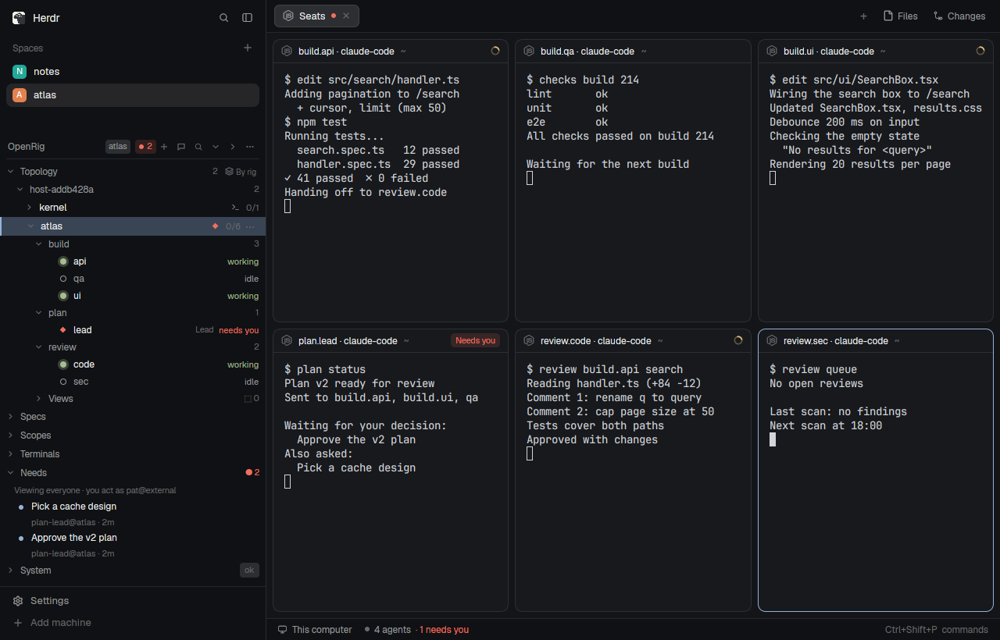

# Herdrig

Version: v0.5.0

**OpenRig Mod for Herdr**

> **EARLY DEVELOPMENT** — This mod is in early development. Contributions are welcome.



Herdrig puts [OpenRig](https://github.com/mvschwarz/openrig) inside the `herdr` window: your rigs, their seats and the
decisions waiting for you, in a sidebar beside your own tabs. Select a row, then double-click or press Enter to open its page, and you can
act from there (answer a request, message a seat, attach to it) without leaving Herdr.

Inside Herdr, use Herdrig’s views. To open OpenRig’s own terminal view there, use `rig terminal open --window`.

## Features

- **Box setup:** choose OpenRig's connected Herdr machine in one screen naming its account, helper and SHA-256.
  A changed helper asks again; existing Local spaces offer Move or Keep here.
- **Specs on the box:** Save and Copy & edit use separate permission for the box's spec folders, with a verified
  helper, changed-file checks and draft recovery. Built-ins stay unchanged; copies retain their built-in agent references.
- **Clear page navigation:** location breadcrumbs and one tab row per object; narrow pages stack labels and controls.
- **Workflow views:** Scopes shows a mission's workflows, current packets, obligations and plan sources. Suggested
  commands are copyable text, never run by Herdrig. Lifecycle receipts are not product acceptance.
- **Not reported:** a running seat without a usable activity report has its own dashed mark, group and filter;
  it never counts as idle.
- **Absolute times:** UTC and Etc/UTC are supported exactly. Other configured zones use this computer's local time,
  with a quiet note in Configuration; exact timestamps include their numeric offset. Relative ages are unchanged.
- **Seat now lines:** visible screen narration and tool status beside rig rows, with selectable cleaned lines on
  hover and on the seat page. Drafts, incoming messages and terminal seats are excluded; ambiguous input stays blank.
- **Calm status marks:** working dots stay visible without continuous animation; a seat starting work or a new
  request gets one brief pulse. Action spinners still show work in progress.

- **Archive and Restore:** hide a rig reversibly from its menu, then restore it stopped from Topology's Archived list.
- **Plain seat activity:** readable status and context, with copyable raw details in **How OpenRig knows**.
- **Sidebar tree** with six branches: **Topology** (host, rig, pod, seat, helper), **Specs**, **Scopes**,
  **Terminals**, **Needs** and **System**, each seat with its status and context usage.
- **Spaces list and layout:** open **System → Layout** in the sidebar or on the System page to choose Herdr's Spaces list, herdrig's list, or both.
- **The Page:** the full view of whatever you select. A rig, a seat card, a spec you can edit in place, or the files
  OpenRig reports.
- **Rig graphs:** saved rig specs start with a static Graph/YAML view and Launch. Running rigs show pod and seat
  routes, hover/keyboard selection and briefly lit handoff paths. Dense edges group by pod; the text Edges list stays
  available. Saved previews come from your connected OpenRig server, including a host-to-box tunnel.
  Set `"reducedMotion": true` in `<appHome>/openrig/config.json` to skip entrance, fades and status pulses.
- **Needs answered in place:** human requests render as Decision Cards (Approve, Deny with a reason, answer the
  questions, or reply in your own words), with quiet hours and modes in **System → People**.
- **Command palette** on `ctrl-alt-r`.
- **Connected assistants:** queue-checking team members have a folded group under their rig, All seats rows and a read-only detail page. Their own check-in words stay separate from activity counts; Queue work, Copy address and Open rig page are their only actions. Older OpenRig versions without the roster route show nothing.
- **Right-click menus** on seats (send, queue, pause or resume, change model), Needs requests, specs and slices.
- **Attach** opens a live seat in its own tab, and Herdr's **Agents** section shows its status.
- **Follows your space:** the sidebar folds outside OpenRig's spaces, keeping Needs you and search visible. Click its
  header to expand until you change spaces. Pages go to their rig's existing space or the **OpenRig** home, which
  also holds the TUI on OpenRig's selected machine. Personal spaces stay free of new Rig tabs. Existing tabs offer **Move** or **Keep here**.
- **More than one OpenRig:** one sidebar for this computer's OpenRig and your Herdr machines'; see
  [Using more than one OpenRig](#using-more-than-one-openrig).
- **Works with or without OpenRig running:** when OpenRig is missing, stopped or unhealthy, the sidebar says so in
  plain words, with the fix (for example **Start OpenRig**). Controls your OpenRig version doesn't support are greyed
  out, each with its reason.

## Install

In Herdr, tell your agent:

```
Read ~/.config/herdr-app/AGENTS.md, then add this mod: herdr.dev/mods/w4rc0n/herdrig
```

Or give [`RECIPE.md`](RECIPE.md) to your `herdr` agent. It checks for OpenRig (and installs it with OpenRig's own guide
only on your yes), copies the five mod folders (`mods/rig`, `mods/rig-view`, `mods/rig-palette`, `mods/rig-menu`, `mods/rig-spaces`)
into `<appHome>/mods/`, merges `ctrl-alt-r` into `keys.json`, and adds `{ "mod": "rig" }` to your layout after telling
you.

Herdr doesn't review mods: check what your agent runs and which keys it changes.

## Updating

After updating, Attach again to each seat whose Attach tab you opened before the update and choose **Replace viewer**: it stops the old helper, closes its tab and starts the current one. Closing those tabs and attaching again does the same. A tab left open keeps using the old helper until it is replaced or closed.
v0.5.0 updates the Attach helper, so Herdr asks you once to approve it again on each configured Herdr machine. Local
Attach doesn't ask.

Replace the five folders `rig`, `rig-view`, `rig-palette`, `rig-menu` and `rig-spaces` in `<appHome>/mods/` with the new
release's folders, one at a time. Replace only those named folders; never use `--delete` on the whole mods folder.
Restart herdr-app after all five are copied. Your folds and settings are kept outside those folders.
Check the `Version:` line in the README you copied, or open System and read **Herdrig Version**.

## Requirements

- **Herdr:** `herdr-app` and `hc`.
- **OpenRig:** the `rig` CLI and its local daemon, used exactly as you have it set up (its home, port and sign-in).
  - Decision Cards and browsing: OpenRig `0.7.7` or later.
  - The concurrency guard (`expectedRevision`, which keeps your draft if a request changed while open) and the
    `operationId` retry (**Check and finish**): `0.7.9` or later.
  - On an older OpenRig, the controls it can't support are disabled with their reason; the rest works.

## What it does on your machine

- **Network:** only OpenRig's local address (`127.0.0.1:7433` unless your OpenRig uses another port), over HTTP and SSE.
  It reads live state; write requests follow your actions:
  - a Decision Card act;
  - a usage refresh;
  - spec validation and library sync, when you save a spec or copy one to the library.
  - a per-setting save or reset in System → Configuration. Saved boot settings may still need a daemon restart;
    Herdrig never restarts OpenRig.

  With a configured Herdr machine, `hc` also carries approved helper commands and spec content to that machine.
- **Programs:** `rig` (and `rig daemon start` when you click **Start OpenRig**); for Attach, `hc` starts `node` on the
  mod's own `rig-attach-relay.cjs`, which runs `tmux attach-session -t =<session>` directly, with no shell, for a
  session name OpenRig makes; `hc` also opens the TUI tab. For the local spec editor, `printenv OPENRIG_HOME` and `realpath`.
  On a configured machine, pinned helpers run through `hc exec`; spec content travels on stdin, without staging
  a remote transfer file. Helper installation and verification use that machine's ordinary file and identity tools.
- **Files:** it reads `<appHome>/openrig/config.json` (optional: your OpenRig name), `<appHome>/openrig/state.json`,
  and the spec and slice files you open in its viewer. It writes `<appHome>/openrig/state.json` and the user spec files
  you edit and save in its spec editor. Local edits are limited to this machine's spec folders, with symlinks resolved:
  OpenRig's spec library `<OpenRig home>/specs`, and `workspace.specs_root` from the local `rig`. The home is
  `openrigHome` if you set it, else `OPENRIG_HOME` in Herdr's environment, else `~/.openrig`, so a default install
  edits with no setup. A link out of those folders, or a path only the daemon names, is refused. It reads none of
  OpenRig's own files.

  Remote saves instead use the configured machine's own resolved user spec folders. Separate permission names
  those folders, the account and the spec helper's checksum; a changed folder or helper asks again. The helper
  refuses built-in or unsafe roots and compares the previous file bytes before replacing it. Copy creates a new
  file. Unsaved edits persist in Herdr's shared state, scoped by daemon, machine and spec. Consent and connection
  records stay under `<appHome>/openrig/`; the local spec transfer file is removed after use.

The full list, with every route, is in [`RECIPE.md`](RECIPE.md) under **Built from**.

## Security update

**Update now.** Earlier versions ran the daemon's attach command through a shell. This version starts `tmux` itself,
with no shell, and attaches only to session names OpenRig makes.

Earlier versions' **Copy & edit** for a spec could read a file the OpenRig daemon named on your machine and send it
to the daemon. This version copies only the spec text OpenRig served.

## Worker views (OpenRig 0.7.12 and later)

v0.5.0's native checks ran on OpenRig 0.7.14, 0.7.16 and 0.7.17 with herdr-app 0.1.16 (on 0.7.16 and 0.7.17: install from the release package, an upgrade from 0.7.14 and 0.7.16 respectively, Attach and Needs on two machines). The API/CLI compatibility smoke ran on OpenRig 0.7.13, and native worker-view checks on 0.7.12.

[The herdr-app provider](https://github.com/mvschwarz/openrig/pull/2744) opens worker
views in the Herdr window on the **same machine as OpenRig**. Worker view, **Show in worker view**, and saved-view
preview + Open turn on when that provider reports the window available. Herdrig checks availability and supported
verbs, not the version number alone. A tunnel alone cannot make that provider reach a window on your computer.
Herdrig can't close those provider views yet: close one with `rig terminal close <view-id>` or close its Herdr tab.
With a custom app home, give the close command the same `--app-home` as the open command.
Opening a worker view can leave a progress spinner visible after the view has opened. Inspect the opened view
before retrying: another Open creates another view.
Attach, the TUI tab and Herdrig's own Seats grids use their separate connection paths.

When `daemonMachine` is configured and the provider has no window, **Worker view** instead opens Herdrig's
worker pages here through the approved helper on that machine. Saved views keep their page geometry; read-only
seats reject typing. Commands from a preview are never executed. **Follow** adds new seats without rebuilding
live viewers. Optional **herdrig prune**, off by default, removes only verified, unfocused inactive viewers after
5, 10 or 30 minutes; the seats keep running. Personal panes, changed viewers and restored shells stay.
Failed refreshes pause following with **Retry**, with no local fallback. Reopening selects the existing pages.
If a saved view changes a retained tile's read-only mode, close its worker tab and reopen; Herdrig never
silently relabels an interactive viewer as read-only or replaces it. Design and cell editing stay provider-only.

The same release includes [pull-mode relay delivery](https://github.com/mvschwarz/openrig/pull/2844),
[unsetting a person's gateway binding](https://github.com/mvschwarz/openrig/pull/2812), and
[typing into writable tiles on older tmux](https://github.com/mvschwarz/openrig/pull/2821).
[Quoting session names in attach commands](https://github.com/mvschwarz/openrig/pull/2971) is included from OpenRig 0.7.13.
Local and remote Seats tiles fit their panes when alone and yield sizing to Attach when it is open (tmux 3.2+).
Sizing settles within about five seconds; a quicker Seats revisit can briefly resize Attach.
Remote Seats use the verified relay on the configured machine; only each tile's own client flags change.

**More than one OpenRig:** for an OpenRig added on another Herdr machine, worker views use Herdrig's worker pages
where that OpenRig offers them, and never the provider (it would need this computer's app home, which means nothing
on that machine). Otherwise its worker views say they aren't available from this computer yet, and nothing is sent.

**Provider limits:** Follow and auto-prune for herdr-app, custom worker-view grids (`--grid`/`--replace`), and
cell editing (`close --cell`) are not supported on upstream main yet. Those controls stay greyed out until OpenRig
adds the required support. The provider release alone will not enable them; no release date is promised.

## Using more than one OpenRig

Herdrig can show several OpenRigs: one on this computer and one on each Herdr machine where you run OpenRig.

**Adding a machine.** When you open a space on a Herdr machine that has no OpenRig connection yet, Herdrig looks
there once. If OpenRig answers, the note under the sidebar header says "OpenRig also runs on `<machine>`. Show its
rigs here too?" with **Add `<machine>`…** and **Not now**. This works with one OpenRig or several. If nothing
answers, the note says the sidebar still shows your current OpenRig; **Find where OpenRig runs** looks again.
**Not now** is remembered for that machine until you look again. You can also add one by hand: **Add a machine…**
in the sidebar's **⋯** menu, or in **System › Connections**, lists your connected Herdr machines that have no
connection yet.

The **Add `<machine>`** screen shows how this computer reaches that machine's OpenRig:
- **Address:** the local end of an SSH tunnel to that machine, prefilled with the next free loopback address and that
  machine's OpenRig port (for example `http://127.0.0.2:7433`).
- **The tunnel command** to run yourself, with **Copy**, for example
  `ssh -N -L 127.0.0.2:7433:127.0.0.1:7433 <machine>`. Herdr never creates the tunnel.
- **OpenRig home on this computer:** the folder `rig` on this computer uses for that machine's OpenRig (its
  settings and sign-in). Each OpenRig needs its own.

Start the tunnel, then press **Check**. Check confirms that the address reaches *that machine's* OpenRig. If it
reaches nothing, a different OpenRig, or an address another connection already uses, it says so, and nothing is
saved. **Save** turns on only after a passing Check of the address as typed, and it saves exactly that address.
The first time you Attach (or open an Operator or rig space) on the new machine, Herdrig asks once for permission to
install its helper there.

With two or more OpenRigs, **System › Connections** lists each one with its state, its address, its host, whether its
helper is approved, and its OpenRig home, plus **Add a machine…** at the end. **Remove…** asks first, then takes that
OpenRig's rigs and requests out of the sidebar. Its spaces and tiles stay as they are, and nothing on that machine
changes.

Connections are saved in `<appHome>/openrig/config.json` as a `connections` list. Each entry has an `id`, the
`machine` (empty for this computer), the `daemonUrl` this computer uses to reach it, and its `openrigHome`: a folder
on this computer, never sent to the machine. A config with only `daemonUrl` and `daemonMachine` keeps working as one
connection; nothing is rewritten.

**What the sidebar shows.** One OpenRig at a time, named in the header. Requests waiting on the others show as
**◆ N elsewhere**.

**How it picks the OpenRig.** It follows your space:
- in a space on a Herdr machine, that machine's OpenRig;
- in this computer's spaces, this computer's OpenRig;
- outside OpenRig's spaces, the one you used last.

Open the picker from the header (or Alt+S) to look at another one; the choice holds until you change spaces.

**Spaces.** Each rig has one space per machine, under that machine in Herdr's Spaces list, and each machine has its
own **OpenRig** home space. Actions, pages, settings, specs, health and worker views act for the OpenRig the row or
page came from, and each Rig tab keeps to its own OpenRig's pages.

**Limits.**
- One OpenRig per Herdr machine you add. Herdrig reaches each added machine's default OpenRig. With two OpenRigs added
  on the same machine, commands for them there say "Two OpenRigs on <machine> need a home for each; this version
  supports one per machine." and nothing is sent.
- Adding a second OpenRig for a machine that already has one is refused ("`<machine>` already has a connection.").
- OpenRig's own herdr-app provider still opens worker views only on its own machine. Herdrig's worker pages,
  Attach and Seats grids work on each machine.
- If a machine's OpenRig address changes, Herdrig asks once before it treats that machine's existing rig spaces as its
  own.
- With more than one OpenRig added, **Copy & edit** of a built-in spec that has its own folder (such as `starter`) works
  on this computer only for the OpenRig that uses this computer's default OpenRig home (`~/.openrig`). For another
  OpenRig on this computer it says why it can't copy there, and nothing is copied.

## Known limitations

- Herdr-app [v0.1.16](https://github.com/herdrdev/herdr-app/releases/tag/v0.1.16) includes [#977](https://github.com/herdrdev/herdr-app/pull/977), which keeps the active space in view. Update Herdr if you are using an older version.
- **Provider worker views need one machine.** OpenRig's own provider must reach a Herdr window on its machine.
  Herdrig's configured-machine worker pages, Attach and Seats grids use separate paths.
- **With upstream OpenRig's own `herdr-app` provider** serving the window, the four mods work with less chrome: no
  cell-level seat identity, follow countdown or per-view row.
- **Follow and auto-prune** require herdr-app support plus both `--follow` and `--prune-after` in `rig terminal open`.
- **Some actions need your OpenRig name.** Sending, queueing, changing a seat's model, and editing quiet hours or
  modes stay disabled with a hint until `<appHome>/openrig/config.json` names you. Decision Cards work without it.
- **Only `ctrl-alt-r` is bound.** Merge it, and ask before replacing a key you already use.
- **The sidebar wants 260 px.** It's cramped between 160 and 260 px, and becomes a rail of rig chips below 160.
- **The folders go together.** Copying only some leaves menus and the palette opening nothing (and, without `rig-spaces`, System → Layout says herdrig's Spaces list isn't installed). Don't rename them
  without editing the `MOD_IDS` map in each folder's `rig-lib.js` (see **Watch out** in the recipe).

## Contributing

Issues and pull requests are welcome.

## Colors

The Rig panes draw a working seat in your theme's green (`ansi2`). herdr's own lists (its Agents section and tab dots) use herdr's `working` color, yellow in the shipped themes. To make them match, add `"colors": { "working": "ansi2" }` to your layout's root node. It names a theme color, so it works in light and dark.

## License

[MIT](LICENSE) — Copyright (c) 2026 w4rc0n, except the Apache-2.0 derived file below.

## Third-party code

Part of the sidebar's priority view is derived from herdr-app (Apache-2.0), see
[LICENSES/herdr-app-Apache-2.0.txt](LICENSES/herdr-app-Apache-2.0.txt). Its modified code is in `rig-needs-view.js`.
