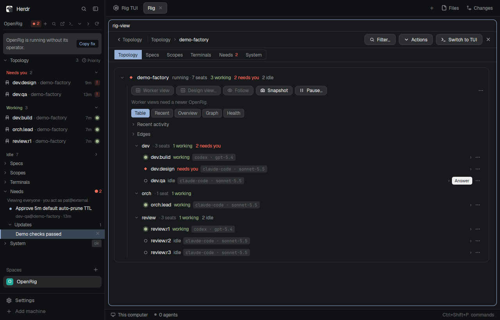

# Herdrig

Herdrig brings OpenRig into the `herdr` window: a sidebar with six collapsible branches of a rig's live topology,
specs, scopes, terminals, needs-you items and system state, where every row opens a full graphical page in its own
tab. The Page and the TUI are pop-outs of the sidebar, not modes — the sidebar always stays put while you read.

Before you install it: this mod **reaches OpenRig's local address** (`127.0.0.1:7433` unless that OpenRig uses another
port) over HTTP and SSE (reads live state and, when you click an action, posts to OpenRig: Decision Card acts, a usage
refresh, spec validation and library sync), **runs programs** (`rig`, `tmux` through OpenRig's own attach command,
`hc`, `node`), **reads files outside its own folder**: `<appHome>/openrig/config.json` (optional: the person's OpenRig
name), `state.json`, and the spec/slice files you open in its file viewer (`SPEC.md`, `PROGRESS.md` and similar, from
the folders OpenRig reports), and **writes** `<appHome>/openrig/state.json` plus the user spec file you edit and save
in its spec editor (only files in OpenRig's spec library). It **runs the `rig` CLI, which uses the person's existing
OpenRig setup** (its home, port and sign-in); it reads none of OpenRig's own files. With a click, **Start
OpenRig** runs `rig daemon start`. It does nothing else on the network.

## Before you add it: OpenRig

This mod shows OpenRig in Herdr. It doesn't install anything. If the person has no OpenRig yet, **you** install it
with OpenRig's own guide. If they have one, you use it exactly as it is. **You're done when the person is talking to
OpenRig's operator in a Herdr tab.** A running daemon or a filled sidebar isn't done on its own.

Start with `rig --version`.

### If it prints nothing: install OpenRig

OpenRig's own setup guide is the procedure: the **`rigs` skill**, step 1, and
[reference/getting-started.md](https://github.com/mvschwarz/openrig/blob/main/docs/reference/getting-started.md).
Follow it, with these points for someone already in Herdr:

1. **Say what will change, and wait for a yes.** Use OpenRig's own list,
   [What OpenRig changes on your machine](https://github.com/mvschwarz/openrig#what-openrig-changes-on-your-machine),
   and ask which account the team should use: Claude, Codex or both. In the same message, ask about Herdr, in these
   words:

   > OpenRig's setup also installs **Herdr**, the older terminal app, for its own view. You're already in herdr-app,
   > so you don't need it: I'll skip it (`--no-herdr`) unless you want it.

2. **Show the plan first.** Run `sh install.sh --dry-run` from OpenRig's `scripts/install.sh`, then
   `rig setup --dry-run` once the CLI is installed, and show the person both.

3. **Install.**
   - If they **skip Herdr** (the usual answer), use the manual route that `install.sh` wraps, because the script always
     runs plain `rig setup`:
     `npm install -g @openrig/cli`, then `rig setup --providers <claude|codex|both> --no-herdr`, then `rig doctor`.
   - If they **want Herdr too**, `sh install.sh` as OpenRig documents it.

4. **Start it.** `rig daemon start`. That also starts OpenRig's own team, the **kernel**, whose **operator** helps
   the person set up their project team. Keep it. Then read `rig status` (the `Kernel:` line) and
   `rig ps --nodes --rig kernel`. Started isn't ready.

Then go to **Add the mod**.

### If it prints a version: use the OpenRig that's there

- **Don't reinstall, don't re-run setup, and don't change its port, home or config.** Don't start a second daemon.
  `rig status --json` tells you what's running.
- **Stopped** (`"state": "stopped"`): say so, then run `rig daemon start`, or leave it to the sidebar's **Start
  OpenRig** button.
- **Running without its operator** (`kernel.state` is `skipped`, or there's no `kernel` rig): say what you found and
  offer `rig up kernel --existing`. Run it only on a yes.
- **Older OpenRig:** the mod greys out what that version can't do, each control with its reason, and works for the
  rest. If the person wants those controls, suggest OpenRig's own upgrade route (its README, "Upgrading an existing
  instance", and its `openrig-upgrade` skill, which keeps live seats running). **Upgrade only on their yes, and
  only that way.**
- Their teams, kernel and seats show up as they are. Nothing gets re-created.

### Add the mod

Copy the folders and fit the sidebar into their layout, as **Built from** and **Watch out** below describe. Do this
the same way on both paths.

**Their OpenRig name (optional).** Sending, queueing, changing a seat's model, and editing quiet hours or modes in
**System → People** record which registered person ran the `rig` command; without a name in `config.json`, those CLI
controls stay disabled with a hint while **Needs** Decision Card actions (`POST /api/mission-control/action`, which
falls back to `human@host` with `authority: "primary-user"` when unattributed) and everything else work.
- `rig gateway participants --json` lists the people OpenRig knows.
- If the person is there and confirms it's them, or after
  `rig gateway human add <name> --display-name "<Name>" --delivery-class B` on their yes, write this one file. It's the
  mod's own, not OpenRig's:
  `~/.config/herdr-app/openrig/config.json` → `{ "person": "<name>@external" }`
- Never guess the name.

### Done when

1. The sidebar shows their rigs, with no message above the tree.
2. **Open the operator in Herdr:** click the speech-bubble icon in the sidebar's header (**Talk to the operator**),
   or run `herdr-app do rig.operator`. An **Operator** tab opens with the operator's conversation.
   - **Don't use `rig terminal open saved:kernel --window` here.** Inside Herdr it reads as a desktop terminal, so it
     opens a separate window, or fails on a headless machine. It doesn't open a Herdr tab.
3. **The person is talking to the operator.** They type what they want built, and which project folder, in that tab.
   Or, with their yes, send it for them, as OpenRig's `rigs` skill step 2 does:
   `rig send operator-agent@kernel 'This is the agent that installed OpenRig. The person will answer in your pane. Goal: <goal>. Project folder: <absolute path>.'`
   If they'd rather talk later, say the handoff is still pending. The way back is the same icon.

### If the sidebar shows a message

The sidebar and these steps use the same words.

| The sidebar says | What it means | Do |
|---|---|---|
| "OpenRig isn't installed." | No `rig` on Herdr's PATH | Install it (above). If you just installed it and the message stays, restart Herdr once so it picks up the new PATH. Don't edit PATH. |
| "OpenRig is installed, but it isn't running." | Daemon stopped | `rig daemon start`, or the **Start OpenRig** button |
| "OpenRig isn't answering." | The CLI and the window disagree, or the daemon is unhealthy | `rig status`, then OpenRig's help: `rig context get help` |
| "OpenRig's operator is starting." | Kernel booting | Wait. It clears by itself. |
| "OpenRig is running without its operator." | Kernel skipped or stopped | Offer `rig up kernel --existing` (copied by **Copy fix**) |
| "The operator can't start: no Claude Code or Codex sign-in." | No working login | `rig doctor`, then OpenRig's sign-in steps |
| "The operator isn't running." | Kernel failed or degraded | `rig ps --nodes --rig kernel`, then OpenRig's "Incomplete setup and restart" table |
| "The rig command failed." | `rig` exists but errors | Read its message, then `rig context get help` |

For anything else, OpenRig's own help is the source: `rig context get help`. Don't improvise a recovery.

## What you see

A **260 px** sidebar block at the top of the window's sidebar column (below **160 px** the mod draws a compact rail
instead — see *How it behaves*). To the right is your own tab area, untouched.

Top to bottom:

1. **Header, 30 px**, on `t.chrome`. Left: the title **OpenRig** in 12 px semibold, `t.muted`. Beside it, when
   something needs you, a small pill — a 6 px `t.blocked` dot and the count in 10.5 px semibold on
   `t.blocked` at 15 % alpha. Right, in order, six 12 px icons that dim until hovered:
   search (the command palette), a box with an arrow leaving it (*open the Page tab*), `>_` (*open the Rig TUI
   tab*), chevron-down (*expand all*), chevron-right (*collapse all*), refresh.
2. **The tree**, scrolling, filling the rest. Six top-level branches, each with a 12 px chevron in `t.dim`:
   **Topology**, **Specs**, **Scopes**, **Terminals**, **Needs**, **System**. A branch row is 24 px; children indent
   12 px per level; every row is 22 px with a `t.hover` background on hover.
   - **Topology** — `host` → `rig` → `Views` → `pod` → `seat` → helper. A rig row carries its name in 12.5 px
     semibold and, when it is not running, a `(stopped)` or `(recoverable)` suffix in 10.5 px `t.dim` plus a small
     **Resume…** pill. A seat row carries its status dot, the seat name in 12 px, the **status word** in 11 px
     (`working` / `blocked` / `idle` / `done`) in that status's colour, and **context usage** (`ctx%`, e.g. `52%`,
     rounded) in 10.5 px `t.dim` (`t.blocked` above 85 %) when reported by the daemon (matching `CONTEXT · N%` on the
     seat page).
   - **Specs** — a filter row, then `Rig`, `Agent`, `Workflow`. Agent specs group in `namespace/` folders, closed.
   - **Scopes** — `project` → `mission` → `slice`.
   - **Terminals** — `Saved` and `Derived`, each listing views with a readiness line.
   - **Needs** — `Human requests`, `Updates`. The count that matters is in the header, so collapsing this never
     hides it. When quiet hours or a mode is active, the `Needs` branch row also carries a compact moon chip
     (`☾ 08:00` or `<Mode>`) that opens **System → People** on click.
   - **System** — `Health`, `People`, `Configuration` (its categories), `Connections`, `Usage`, `Usage · all hosts`,
     `Cost`.

The Page tab, when open, is the high-detail rendering of whatever the sidebar selected: a rig as one block with
counts, actions and pod lines; a seat as a ten-section card (`CONTEXT · N%`, `CURRENT ACTIVITY`, `HEALTH`,
`CURRENT WORK`, `QUEUE`, `UP NEXT`, `NEEDS YOU`, `RECENTLY FINISHED`, `SEAT`, `SPEC`); a **Needs** request as a
9-part **Decision Card** (tier strip `Escalated — needs you now` or `Needs you now`, `From <asker> Open seat · to
<recipient> · <scope> · since <at>`, body and `Unblocks`, structured question option pills with `recommended` tags,
clickable evidence files, distinct acts — **Approve**, two-step **Deny…** → **Deny with this reason**, **Send
answers**, and **Send as my answer** or **Resolve with these words** — an own-words draft box, the 11 px `t.dim`
record sentence that swaps in place when hovering **Approve**, and a collapsed `What OpenRig recorded` fold), along
with a `Whose Queue` (`Mine` / `Default` / `Everyone`) bar and a `Since you were away` card (with the coming-back
account of delegated mode decisions); **System → People** with delivery readiness, a factual dead-binding notice when
a configured connector (`slack` / `telegram` / `imessage`) isn't ready, quiet hours (`Quiet for 1h`, `Quiet for 2h`,
`Daily 22:00–08:00`, `I'm back`), and saved modes (`sleep`, `focus`, custom modes, decision-room words, `I'm back`);
and a spec editable in place.

All colour comes from the theme (`t.fg`, `t.muted`, `t.dim`, `t.accent`, `t.blocked`, `t.working`, `t.border`,
`t.chrome`, `t.raised`, `t.hover`), so the sidebar follows your light or dark theme. There is exactly one accent
use per row at most: a 2 px `t.accent` left rail on the selected row.

## How it behaves

**Agent status.** The sidebar draws each status as a **dot**, not a typed glyph, so it reads at 7 px:

- **working** — an 11 px spinning ring (Herdr's own `spinner.svg`, 900 ms per turn) in `t.working`.
- **blocked / needs you** — a 7 px filled disc in `t.blocked`.
- **idle**, **done** — a 7 px ring with a transparent centre in the tone's colour, so the shape is an outline
  rather than a blob.
- **anything else, including unknown** — a 7 px disc in `t.dim`. The sidebar never invents a filled `t.working`
  disc for a state it does not know.

The **seat page** in the Page tab uses the typed fold for the same states, matching `rig tui` exactly:
`✕` failed · `◐` needs you · `●` working · `●` idle · `○` unknown. Two renderings of one truth — a dot where the
row is 7 px tall, a glyph where there is room — not two different vocabularies.

**What moves.** Status dots and status words change as the daemon reports; the needs-you pill counts up and
down; a following view's pane header shows its countdown. Nothing in the sidebar re-orders itself: your sibling
order is yours (below).

**Clicks.** A branch row toggles that branch and selects it. A **node** row selects, and opens that node's page in
the Page tab — opening the tab if it is not there yet. Every row shows a small box-with-arrow icon that opens the
Page tab at that node too. **A row click never collapses or expands anything**, and **following a link inside the
Page never moves the sidebar**: folds, scroll and the selected row stay exactly where you left them. When the Page
has since gone somewhere else, your selected row shows a muted `·` beside it — a hint that you are reading
elsewhere, not a second selection.

**Hover.** Rows take `t.hover`. The Page pop-out icon brightens. Dragging a row vertically past 4 px reorders it
among its own siblings — rigs among rigs, pods among pods, seats within their pod, views within their rig. The
dragged row dims and a 2 px `t.accent` line shows where it will land. **You cannot drag across groups**: a rig can
never reorder a spec, and a drop in a different group is refused rather than ignored. Order is remembered across
restarts and never changes your rig.

**Keys.** `ctrl-alt-r` opens the command palette. In the tree: `up`/`down` move through visible rows (collapsed
subtrees are skipped), `right` expands or enters a child, `left` collapses or goes to the parent, `enter` opens the
page. `alt`+arrows move between Herdr's panes as usual.

**Attach.** On a live seat's page, **Attach** opens that seat's session interactively in its own tab named after
the seat, and a second Attach focuses the first rather than opening another. Your keystrokes go to the agent. The
attached tab also reports the seat's status to Herdr, which is why an attached seat appears in Herdr's **Agents**
section with a live badge. Attach is disabled with a reason on a stopped seat.

**When OpenRig is not reachable.** The tree shows a one-line, plain-words message in `t.muted` saying what failed
and what to do; it does not spin or fake data. Counts that the daemon did not serve render as `?` or `·`, never as
a confident `0`.

**Narrow windows.** Below 160 px the sidebar becomes a rail: one two-letter chip per rig with its status dot, so a
split window still answers "which rig needs me".

**Needs, quiet hours, modes, and OpenRig `0.7.7` vs `0.7.9`.** Needs items are sorted into four tiers: `escalation`,
`alert`, `routine`, and `update` (updates have no action buttons and display *"No action needed. Viewing isn't
approval or proof of delivery."*). While quiet hours or a quiet-carrying mode are active, the mod holds its own
routine and alert toasts (marking them seen so they wait in **Needs**) while `escalation` toasts still fire. All
Decision Card actions (**Approve**, **Deny**, structured question choices, free-text answers, **Send answers back to
`<asker>`**, and **Resolve**) work on OpenRig `0.7.7+` via `POST /api/mission-control/action`. The optimistic
concurrency guard (`expectedRevision` from `/api/queue/:id`'s `decisionRevision`, catching a request that changed
while open and keeping your draft) and idempotent `operationId` retry (**Check and finish** on network failure) use
OpenRig `0.7.9+`; on `< 0.7.9`, the card displays a one-line note that `decisionRevision` is absent and omits
`expectedRevision`.

**What writes to OpenRig.** Nothing writes in the background or on its own. When you act on a **Needs** Decision Card
(**Approve**, **Deny with this reason**, **Send answers**, **Send as my answer**, or **Resolve with these words**),
the mod `POST`s your decision to `/api/mission-control/action` (with `actorSession: "<name>@external"` when `person`
is set in `<appHome>/openrig/config.json`, or `actorSession: "human@host"` and `authority: "primary-user"` when
unattributed; never with an `X-OpenRig-Session` header). Clicking **Refresh** on per-host usage `POST`s
`/api/provider/usage/hosts/refresh`. In the spec editor, clicking **Save** on a user spec validates the YAML with
`POST /api/agents/validate` or `POST /api/rigs/import/validate`, writes that user spec file in place (limited to paths
in OpenRig's spec library; built-in specs are not editable), and calls `POST /api/specs/library/sync` (which also runs
after **Copy to library**). Every other write runs a `rig` command you could have typed (`rig send`, `rig queue`,
`rig gateway human quiet|mode …`, `rig specs add …`, `rig snapshot`, `rig seat …`, `rig terminal …`, or
`rig daemon start` when you click **Start OpenRig**).

## Built from

**Blocks.** Four mods, each a folder in `mods/`, each self-contained (its own `main.js`, `mod.json`, `rig-lib.js`
and the 24 `rig-*.svg` icons it draws) — this repo ships exactly these, and nothing else:

| Mod | `place` | Role |
|---|---|---|
| `rig` | `none` | the sidebar tree, header and rail; the `rig-sidebar` block in the layout |
| `rig-view` | `none`, `focusable` | the Page: rig block, seat card, spec editor, files viewer |
| `rig-palette` | `none`, `overlay` 620×420 | the command palette |
| `rig-menu` | `none` | right-click menus, dialogs, the worker-view designer |

**Fitting it into the layout.** All four mods have `"place": "none"` (Herdr only auto-docks a newly seen mod when
`place` is not `"none"`, and never into a shipped layout). After copying the four folders into `<appHome>/mods/`,
the installing agent fits the sidebar into the person's layout in one step (`AGENTS.md` step 3):
1. Tell the person before changing their layout.
2. If the person is on **Herdr (`main`)** (check `herdr-app status`), clone it
   (`herdr-app do layout.clone '{"name":"main"}'`) so their own layout copy is shown and editable. On **Terminals** or
   **Herdr 98**, which have no sidebar column, ask whether they want to switch to a clone of `main` for OpenRig, or add
   a 260 px left column (`id: "sidebar"`) themselves. Don't build one unasked.
3. In `main`'s clone, insert `{ "id": "rig-sidebar", "type": "block", "size": { "weight": 2 }, "content": { "mod": "rig" } }`
   (or a pixel **height** such as `"size": { "px": 260 }`) as the **first child of `sidebar-lists`** (above `spaces`),
   and keep the left column's `id: "sidebar"` at least 260 px wide (`main`'s `sidebar` is 268 px).

It deliberately does **not** ship the per-pane chrome (`rig-cell-header`, `rig-pad`, `rig-ended`, `rig-strip`).
Those belong to whichever daemon writes the layout that references them — upstream OpenRig's `herdr-app` provider
ships its own, and two installers claiming one folder name is what breaks a working setup. See **Watch out**.

**`props` roles.** `rig` takes no props — it reads the layout. `rig-view` takes `{ section, id, name, rig, rigId,
seat, slice, file }` to open at a specific node. `rig-menu` takes `{ target, step }` where `target` names the thing
right-clicked (`seat`, `rig`, `pod`, `need`, `cell`, `spec`, `slice`, `view`) and `step` the dialog or action. The
sidebar reads `rig-cell-header`'s pane props (`seat`, `title`, `views`) when the installed chrome provides them, and
keeps working when it does not.

**Herdr functions and commands it calls.** `run` (`tab.new`, `tab.select`, `tab.rename`, `layout.select`, `layout.resize`,
`pane.split`, `pane.focus`, `pane.zoom`, `mod.open`), `shared` / `setShared`, `layout()`, `spaces()`, `panes()`,
`terminals()`, `theme()`, `openOverlay`, `notify`, `exec`, `hc`, `appHome`, `readTextFile`, `writeTextFile`.

**Programs it runs.** `rig` (the OpenRig CLI — `rig ps`, `rig queue`, `rig gateway human quiet|mode …`, `rig terminal …`,
`rig snapshot`, `rig seat …`, `rig specs …`, the rest of the one-click actions, and, with your yes, **Start OpenRig**
runs `rig daemon start`), `tmux` **only** through OpenRig's recorded `tmuxAttachCommand` for a seat (never a bare
`tmux`), `hc` for attaching (`--label herdr-openrig.role=attach --label herdr-openrig.attach=<session>`) and for the
TUI terminal (`--label herdr-openrig.role=tui`), and `node` for the inline OSC 7501 status relay when attaching a seat.

**Network, programs, files — the full disclosure.** It **reaches OpenRig's local address** (`127.0.0.1:7433` unless
that OpenRig uses another port), read from `rig status --json`, for local HTTP reads (`/healthz`, `/api/kernel/status`,
`/api/ps`, `/api/rigs/*`, `/api/native-seats*`, `/api/attention*`, `/api/queue/*`, `/api/gateway/connections`,
`/api/gateway/participants`, `/api/gateway/human/*`, `/api/health`, `/api/scopes*`, `/api/specs/library`,
`/api/terminal/*`, `/api/provider/usage*`, `/api/telemetry/usage/cost`, `/api/usage*`, `/api/config*`), subscribes to
`/api/activity/events` (SSE) for live state, and sends local HTTP `POST` requests only when you click an action
(`POST /api/mission-control/action` for **Needs** Decision Card acts — `approve`, `deny`, `answer`, `resolve`;
`POST /api/provider/usage/hosts/refresh` when refreshing per-host usage; `POST /api/agents/validate` or
`POST /api/rigs/import/validate` when validating a user spec edit; and `POST /api/specs/library/sync` on **Save** and
after **Copy to library**). It **runs** the programs above; `rig` uses the person's existing OpenRig setup (its home,
port and sign-in), and the mod reads none of OpenRig's own files. With a click, **Start OpenRig** runs
`rig daemon start`. It **reads** `<appHome>/openrig/config.json` (optional: the person's OpenRig name),
`<appHome>/openrig/state.json` (your saved sidebar folds, sibling order, `needsView`, `lastSeenNeedsAt`, and mode
application IDs), and the spec/slice files you open in its file viewer (`SPEC.md`, `PROGRESS.md` and similar, from the
folders OpenRig reports). It **writes** only `<appHome>/openrig/state.json` and the user spec files you edit and save
in its spec editor (only files in OpenRig's spec library; built-in specs are not editable). Nothing leaves the machine.

**Art.** 24 SVGs in each mod folder (`rig-*.svg`), drawn to match Herdr's own `workspace-chrome` weight: a 1.5 px stroke
on a currentColor fill, 16 px nominal, so they dim and tint with the theme rather than carrying colour.

## Watch out

What tripped this build up, and what a fresh build would get wrong:

- **The folders must be self-contained.** An earlier shape kept `rig-lib.js` and the icons in one `_shared/` folder
  and copied them in at install time. That works only when *our* installer runs. A plain folder copy — which is
  exactly what the installation steps describe — gives four mods whose first `import` throws. Every folder here
  carries its own copy, and a `sync --check` keeps the copies identical. **If you rebuild from this recipe, do not
  reintroduce a shared folder that must be copied at install time.**
- **Renaming a folder breaks two things a recipe reader cannot guess.** Each mod resolves its own icons as
  `mods/${MOD_IDS.<role>}/<name>.svg`, and the four mods open each other by name (`rig`, `rig-view`, `rig-palette`,
  `rig-menu`). If your installer renamed a folder because the name was taken, edit the single `MOD_IDS` map at the
  top of `rig-lib.js` in every mod folder — changing that one line updates both cross-mod references and icon paths
  (and if `rig-palette` was renamed, also update the merged `keys.json` action `mod.open:rig-palette` to match).
- **Never write, overwrite or delete the per-pane chrome folders.** `rig-cell-header`, `rig-pad`, `rig-ended` and
  `rig-strip` belong to the daemon that writes the layout referencing them. Two installers claiming one folder name
  is the failure mode that matters: a folder whose *content* differs from what that daemon recorded is **refused**,
  and the provider then fails **every** view with `herdr_app_mods` — it does not degrade, and it does not repair
  itself, because the refusal happens before any write. A *missing* folder is different: that one is reinstalled on
  the next open, so deleting is not a shortcut either — it just breaks a different daemon later.
- **On a window served by upstream OpenRig's `herdr-app` provider, these four mods still work — with less chrome.**
  That provider ships a minimal `rig-cell-header` whose props carry `{ title, detail, ended }` and no `views` or
  `seat`. The sidebar reads both optionally, so nothing throws: you get the tree, the Page, the palette and the maps
  with no cell-level seat identity, no follow countdown and no per-view row. Features that need the native-tab
  bookkeeping are simply absent rather than broken. Say this to the person before installing, so a missing detail
  reads as a known trade and not a bug.
- **Only `ctrl-alt-r` is bound.** The mods expect exactly that one key. Merge it, and ask before replacing a key
  you already use — nothing else is taken.
- **`place` is `"none"`, so the layout must reference `{ "mod": "rig" }`.** Herdr never auto-docks a `"place": "none"`
  mod or modifies a shipped layout on folder discovery. Tell the person before changing their layout; if they are on
  `main`, `layout.clone` it to their own and insert a `{ "mod": "rig" }` block (`"size": { "weight": 2 }` or a pixel
  height) as the first child of `sidebar-lists` (otherwise ask the person).
- **The sidebar wants 260 px of width, and the rail keys off column `id: "sidebar"`.** Below 160 px wide the column with
  `id: "sidebar"` becomes a rail; between 160 and 260 the tree is cramped rather than broken. Keep `id: "sidebar"` if you
  reshape the sidebar, and keep its width at least 260 px (`main`'s is 268 px); if the person shrinks it afterwards,
  they get the cramped tree or the rail, not an error.
- **The designer preview is a fixed 240 px square.** Its divider-drag math uses that constant, so enlarging the
  dialog without changing `DESIGN_SQUARE_PX` makes the drag drift from the pointer.
- **The Page and the TUI are tabs, not modes.** There is no mode setting. If you find a `surface` key in a config,
  it is a leftover from an older build and is ignored.
- **Capabilities are read, not assumed.** The mods disable controls from the live CLI's `--help` text. A
  provider-only daemon (PR 2) has **no `--follow`**, so Follow and auto-prune stay disabled with their reason —
  that is correct behaviour there, not a bug.
- **What this build does not do.** It does not ship a layout (a mod repo must not), so it never owns your tab tree;
  it does not start the OpenRig daemon unless you click **Start OpenRig**, and it does not install OpenRig or seats.

## Done when

Each of these is something this build really does:

1. `herdr-app check mods/rig mods/rig-view mods/rig-palette mods/rig-menu` → all four pass, from the clone, with no
   install step.
2. Copy **all four folders** — `mods/rig`, `mods/rig-view`, `mods/rig-palette`, `mods/rig-menu` — into a throwaway
   `<appHome>/mods/`, clone `main` (`layout.clone`) and insert the `{ "mod": "rig" }` block as the first child of
   `sidebar-lists` in the `sidebar` column → a sidebar titled **OpenRig** with six branches, and a `ctrl-alt-r`
   palette that opens. Copying only some of them is the one shape that half-works: the sidebar draws but its menus
   and palette open nothing.
3. With the daemon running, a rig appears under **Topology** with its seats and their status marks; clicking a seat
   opens the seat page in the Page tab.
4. Collapse **Needs** → the needs-you count stays visible in the header.
5. Select a row, then follow a link inside the Page → the sidebar's folds, scroll and selected row do not move, and
   the selected row shows the muted `·`.
6. Drag a seat row past 4 px onto a sibling in the same pod → the order changes and survives a restart; drag it
   onto a pod in another rig → nothing happens.
7. On a live seat, **Attach** → a tab named after the seat, and that seat listed under Herdr's **Agents** with a
   live badge; attach again → the same tab is focused, no second one appears.
8. `rig terminal open --help` on the installed OpenRig lists `--follow` but **not** `--prune-after` → the Follow
   and prune controls are disabled with their one-line reason rather than failing when used. That is the live
   behaviour the capability probe reads, as described under **Capabilities are read, not assumed** in **Watch out**.
9. Under **Needs**, expanding a human request renders the **Decision Card** (tier strip, `Open seat` link, option pills
   or own-words box, record sentence, and `What OpenRig recorded` fold), and clicking **Approve** or **Send as my
   answer** `POST`s `/api/mission-control/action` and settles the row without flashing the page; opening **System →
   People** (or `:people` in the palette) renders delivery readiness, quiet hours, and saved modes.
